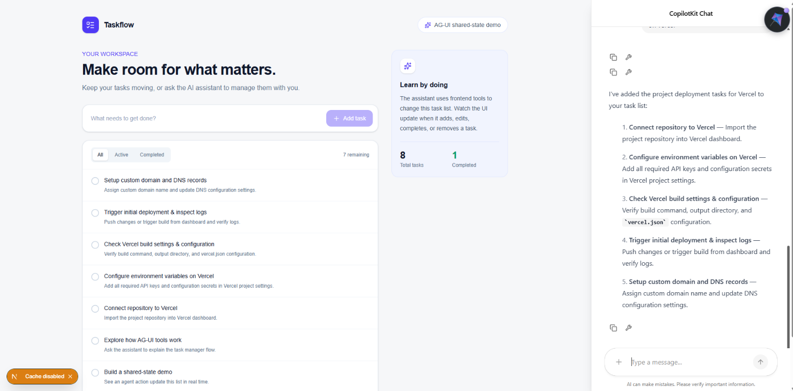

# AG-UI Task Manager

A small learning project for exploring how an AI agent can interact with a
React application through AG-UI and CopilotKit. The assistant can manage the
same task list that is rendered on the page.

## Screenshot



## Run locally

Install dependencies and start the Next.js development server:

```bash
npm install
npm run dev
```

Open [http://localhost:3000](http://localhost:3000). The assistant uses the
Google Gemini model configured in `src/app/api/copilotkit/[[...slug]]/route.ts`;
configure the corresponding provider API key in `.env.local` to use it.

## How the shared-state demo works

`src/app/task-manager.tsx` owns the task list in React state and registers
frontend tools with CopilotKit's `useFrontendTool` hook. When the assistant
calls a tool, its handler updates that state, and React immediately renders the
change in the list and summary counts.

The assistant can:

- List tasks and their IDs with `list_tasks`.
- Add a task with `add_task`.
- Rename a task with `update_task`.
- Mark a task active or complete with `set_task_status`.
- Remove a task with `delete_task`.

Try prompts like “Add a task to review my notes” or “List my tasks and mark the
first one complete.” You can also add, complete, and delete tasks using the
page controls. Both the assistant and the controls affect the same state.

Task data is held in memory for this demo and resets when the page is refreshed.
